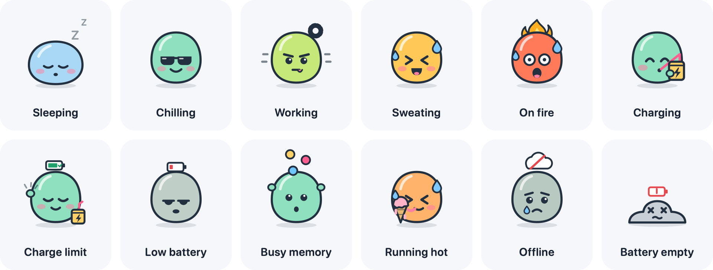
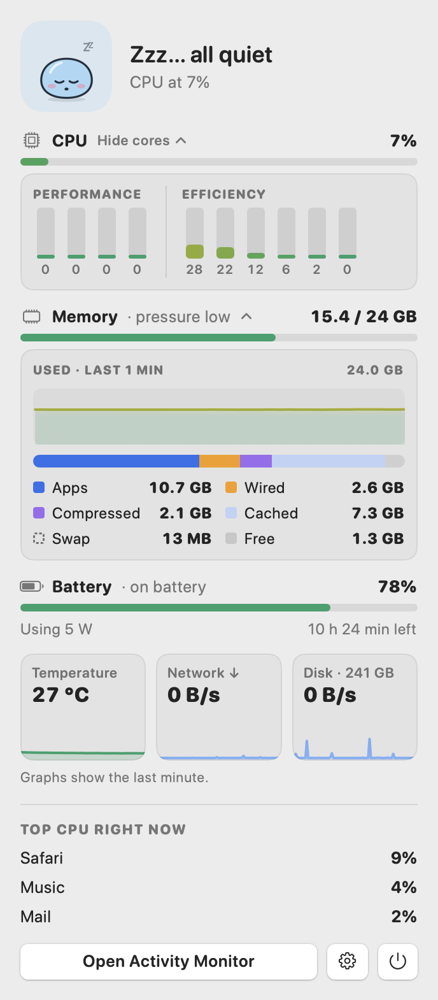
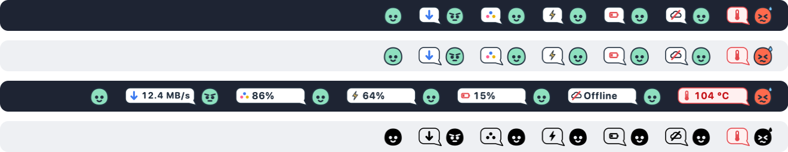

<p align="center">
  
</p>

<h1 align="center">Blipp</h1>

<p align="center">
  A tiny sidekick in your Mac's menu bar who shows how your Mac is doing.<br>
  He sweats when the CPU works hard, sips juice while charging, juggles when memory gets tight
  and melts when the battery is nearly empty.
</p>

<p align="center">
  <a href="https://github.com/ChonkieMonkie/blipp/releases/latest"><b>Download the latest release</b></a>
  · Apple Silicon · macOS 14 or later
</p>

<p align="center">
  
</p>

## What it does

Blipp lives in the menu bar and changes with your Mac, so a glance tells you how it's doing.
Click him for a panel with the numbers behind his mood:

<p align="center">
  <picture>
    <source media="(prefers-color-scheme: dark)" srcset="docs/panel-dark.png">
    
  </picture>
</p>

- **CPU:** total load, plus every core split into performance and efficiency cores.
- **Memory:** pressure, a graph of what's in use, and the same breakdown as Activity Monitor
  (apps, wired, compressed, cached, swap, free).
- **Battery:** charge, charging power in watts and time to full or empty. It also notices your charge limit.
- **Temperature, network and disk:** live values with graphs whose color follows the value.
- **Top processes:** what's using the most CPU right now, counted like Activity Monitor.

## Install

1. Download **Blipp.zip** from the [latest release](https://github.com/ChonkieMonkie/blipp/releases/latest) and unzip it.
2. Move **Blipp.app** to your Applications folder and open it.
3. Blipp isn't notarized by Apple, so macOS blocks it the first time. Click **Done**, then go to
   **System Settings › Privacy & Security**, scroll down and click **Open Anyway** next to Blipp.

If macOS says the app is damaged instead, run this in Terminal and open it again:

```bash
xattr -dr com.apple.quarantine /Applications/Blipp.app
```

Turn on **Launch at login** in Blipp's settings to keep him around. Right-click Blipp for a quick menu
with Settings and Quit.

## How Blipp decides what to show

Every metric owns one part of the figure, so several things can show at once:

| Part           | Driven by |
| -------------- | --------- |
| Body color     | Heat: CPU load or the Mac's thermal state, whichever is higher |
| Face           | CPU load: sleeping, chilling, working, sweating, on fire |
| Hands          | Charging, charge limit, heat, network and disk activity |
| Above the head | Memory pressure (juggling), plus Zzz, a flame or an offline cloud |

Three emergencies take over the whole figure: battery under 5 %, a critical thermal state and heavy
swapping. CPU uses a 5-second average so Blipp doesn't flinch at every spike, and the charging
animation switches between a juice box and a cookie so he doesn't get repetitive.

In the menu bar, Blipp is redrawn with thicker lines so he stays readable at 18 points:

<p align="center">
  
</p>

## Settings

- **Next to Blipp:** nothing, CPU %, mini bars for CPU and memory, or battery %.
- **Style:** color, or monochrome to blend in with the system icons.
- **Animation:** turn the menu bar animation on or off, and choose whether Blipp mixes up his animation variants.
- **Graphs:** update every 0.5 to 5 seconds and show the last 30 seconds up to 1 hour.
- **Update Blipp every:** 1, 2 or 5 seconds, which sets how quickly his mood follows the numbers.
- **Clicking Blipp:** open the panel or go straight to Activity Monitor.
- **Launch at login.**

## Built to run all day

- **Panel closed:** about 0.5 % of one core, roughly one wake-up a second and ~13 MB of memory.
  The panel's views don't exist while it's closed, and details that only show up in it refresh less often.
- **Panel open:** about 3 % of one core while you're looking at it.
- **Displays asleep:** sampling pauses completely. Battery changes still arrive instantly through
  macOS notifications instead of polling.
- **Menu bar:** the icon only redraws when a frame actually changes (a blink, a drop of sweat).

Blipp only reads your own Mac and never sends anything anywhere.

## Build from source

You only need Apple's Command Line Tools, no Xcode:

```bash
git clone https://github.com/ChonkieMonkie/blipp.git
cd blipp
./scripts/build.sh
open build/Blipp.app
```

The Command Line Tools don't include SwiftUI's macro plugin, so the code avoids `@State` and keeps
view state in small `ObservableObject`s instead.

### Where the numbers come from

| Metric        | Source |
| ------------- | ------ |
| CPU per core  | `host_processor_info` |
| Memory        | `host_statistics64`, `vm.swapusage`, `kern.memorystatus_vm_pressure_level` |
| Battery       | IOKit power sources, plus `AppleSmartBattery` for charging watts |
| Temperature   | SoC die sensors via the private IOHIDEventSystem API (see `Sources/CSensors`) |
| Thermal state | `ProcessInfo.thermalState` |
| Network       | 64-bit interface counters (`NET_RT_IFLIST2`), `NWPathMonitor` for offline |
| Disk          | `IOBlockStorageDriver` statistics, free space of the boot volume |
| Top processes | `proc_pid_rusage`, counted like Activity Monitor (100 % = one core) |

Reading the temperature uses a private API. That's fine for an app you run yourself, but it's why
Blipp isn't in the Mac App Store. Each die-sensor read takes about a millisecond, so the sensors are
read a few at a time in rotation and averaged with their latest values.

### Developer tools

```bash
swift build -c release
BIN="$(swift build -c release --show-bin-path)"
"$BIN/Blipp" --benchmark --sensors        # time every sampler and list the temperature sensors
"$BIN/Blipp" --render-gallery /tmp/blipp  # PNGs of every state and menu bar icon
"$BIN/Blipp" --render-readme docs         # regenerate the pictures in this README (takes ~70 s)
open build/Blipp.app --args --debug-panel-cycle  # open the panel, expand and collapse both sections, close it
```

### Project layout

```
Sources/
  CSensors/       C shim for the temperature sensors
  Blipp/
    App/          App delegate, status item, icon export, preview and README renderers
    Blipp/        The figure: scene model, mood engine, SVG path parser, renderers
    Monitor/      Samplers and the SystemMonitor that ties them together
    Settings/     Preferences
    UI/           Panel, settings window, graphs, menu bar icon
```
