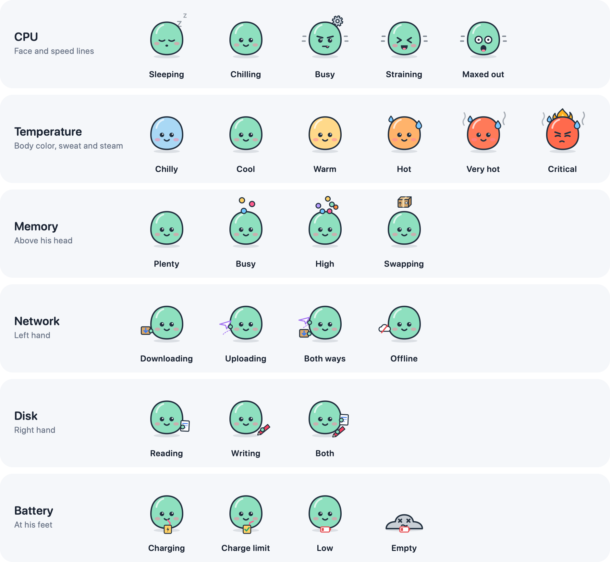

<p align="center">
  
</p>

<h1 align="center">Blipp</h1>

<p align="center">
  A tiny sidekick in your Mac's menu bar who feels everything your Mac feels.<br>
  He naps when it's idle, gets to work when it's busy and boils over when things really go wrong,
  so one glance tells you how your Mac is doing.
</p>

<p align="center">
  <a href="https://github.com/ChonkieMonkie/blipp/releases/latest"><b>Download the latest release</b></a>
  · Apple Silicon · macOS 14 or later
</p>

<p align="center">
  
</p>

## Meet Blipp

Blipp is small, round and a little dramatic. When your Mac has nothing to do, he turns a cool blue
and dozes off. On a regular day he's focused: juggling a few apps, catching a download in one hand,
scribbling to disk with the other and snacking on a cookie while the charger is plugged in. And on a
really bad day, when the chip hits its thermal limit, he turns red, boils over and his head catches fire.

Click him and he says hello with one of a dozen little animations (a hop, a wave, a spin, peeking up
from below), picked to suit his mood. His headline follows what's going on, from
"Dreaming of electric sheep" to "Incoming!" to "Somebody call the fan!", along with the numbers that
matter most right now. Below it is everything behind his mood:

<p align="center">
  <picture>
    <source media="(prefers-color-scheme: dark)" srcset="docs/panel-dark.png">
    
  </picture>
</p>

- **CPU:** total load, plus every core split into performance and efficiency cores.
- **Memory:** pressure, a graph of what's in use, and the same breakdown as Activity Monitor
  (apps, wired, compressed, cached, swap, free).
- **Battery:** charge, charging power in watts and time to full or empty. It also notices your charge limit.
- **Temperature, network and disk:** live values with graphs whose color follows the value.
  Network shows download and upload, and disk shows reads and writes, overlaid on one graph.
- **Top processes:** what's using the most CPU right now, counted like Activity Monitor.

## Install

1. Download **Blipp.zip** from the [latest release](https://github.com/ChonkieMonkie/blipp/releases/latest) and unzip it.
2. Move **Blipp.app** to your Applications folder and open it.
3. Blipp isn't notarized by Apple, so macOS blocks it the first time. Click **Done**, then go to
   **System Settings › Privacy & Security**, scroll down and click **Open Anyway** next to Blipp.

If macOS says the app is damaged instead, run this in Terminal and open it again:

```bash
xattr -dr com.apple.quarantine /Applications/Blipp.app
```

Turn on **Launch at login** in Blipp's settings to keep him around. Right-click Blipp for a quick menu
with Settings and Quit.

## How Blipp shows what's going on

Every signal has its own place on Blipp, so you can read several at once without mixing them up.
Each row goes from calm to extreme:

<p align="center">
  
</p>

| Part                        | Signal | What you'll see |
| --------------------------- | ------ | --------------- |
| Face and speed lines        | CPU load | Asleep under 10 %, relaxed, focused, sweating, and wide-eyed and shaking at the top |
| Body color, sweat and steam | CPU core temperature | Blue under 40 °C, mint, yellow from 60 °C, orange and sweating from 75 °C, red and steaming from 90 °C |
| Above his head              | Memory pressure | Juggling three balls, then five, then packing a moving box when the Mac swaps |
| Left hand                   | Network | A parcel for downloads, a paper plane for uploads, a crossed-out cloud when offline |
| Right hand                  | Disk | A page for reads, a pencil for writes |
| At his feet                 | Battery | A juice box or a cookie while charging, a check mark at your charge limit, a red battery when low |

When his head is free, a Zzz floats above it while he sleeps and a gear spins while he's busy.
CPU uses a 5-second average so Blipp doesn't flinch at every spike, and downloads, uploads and disk
activity only count once they're worth mentioning (1 MB/s, 500 KB/s and 20 MB/s).

Two emergencies take over the whole figure: under 5 % battery he melts into a puddle, and when the
Mac reaches a critical thermal state he boils over with his head on fire.

## In the menu bar

In the menu bar Blipp keeps the same look, redrawn with thicker lines so he stays readable at
18 points. Next to him, a small speech bubble says the one thing worth knowing right now:

<p align="center">
  
</p>

From the top: symbols on a dark and a light menu bar, symbols with values, and monochrome.

The bubble picks the most important thing: an empty battery or critical heat first, in red and even
with the bubble turned off, then low battery, offline, swapping, high memory, charging, downloads,
uploads and disk activity. It changes at the same moment as Blipp himself, and its spot is always
saved, so Blipp never jumps around between your other menu bar icons.

## Settings

- **Speech bubble:** off, a symbol, or a symbol with its value.
- **Show low battery, charging and offline:** macOS already shows these in the menu bar, so you can
  turn them off and the bubble moves on to the next thing.
- **Style:** color, or monochrome to blend in with the system icons.
- **Animation:** turn the menu bar animation on or off, and choose whether Blipp mixes up his animation variants.
- **Graphs:** update every 0.5 to 5 seconds and show the last 30 seconds up to 1 hour.
- **Network speed:** in megabytes (MB/s) like Activity Monitor, or megabits (Mb/s) like internet plans.
- **Update Blipp every:** 1, 2 or 5 seconds, which sets how quickly his mood follows the numbers.
- **Clicking Blipp:** open the panel or go straight to Activity Monitor.
- **Launch at login.**

## Built to run all day

With the default settings (graphs every second):

- **Panel closed:** about 0.5 % of one core and around one wake-up a second.
  The panel's views don't exist while it's closed, and details that only show up in it refresh less often.
- **Panel open:** about 3.5 % of one core while you're looking at it.
- **Slower graphs:** updating every 5 seconds brings that down to about 0.3 % closed and 2.5 % open.
- **Memory:** about 12 MB until you first open the panel, then around 30 MB, because macOS keeps the
  frameworks the panel is drawn with loaded.
- **Displays asleep:** sampling pauses completely. Battery changes still arrive instantly through
  macOS notifications instead of polling.
- **Menu bar:** the icon only redraws when a frame actually changes (a blink, a drop of sweat).

Blipp only reads your own Mac and never sends anything anywhere.

## Build from source

You only need Apple's Command Line Tools, no Xcode:

```bash
git clone https://github.com/ChonkieMonkie/blipp.git
cd blipp
./scripts/build.sh
open build/Blipp.app
```

The Command Line Tools don't include SwiftUI's macro plugin, so the code avoids `@State` and keeps
view state in small `ObservableObject`s instead.

### Where the numbers come from

| Metric        | Source |
| ------------- | ------ |
| CPU per core  | `host_processor_info` |
| Memory        | `host_statistics64`, `vm.swapusage`, `kern.memorystatus_vm_pressure_level` |
| Battery       | IOKit power sources, plus `AppleSmartBattery` for charging watts |
| Temperature   | CPU core sensors in the SMC (`Tp`/`Te` keys), or the SoC die sensors via the private IOHIDEventSystem API on chips without them (see `Sources/CSensors`) |
| Thermal state | `ProcessInfo.thermalState` |
| Network       | 64-bit interface counters (`NET_RT_IFLIST2`), `NWPathMonitor` for offline |
| Disk          | `IOBlockStorageDriver` statistics, free space of the boot volume |
| Top processes | `proc_pid_rusage`, counted like Activity Monitor (100 % = one core) |

Reading the temperature uses undocumented interfaces. That's fine for an app you run yourself, but
it's why Blipp isn't in the Mac App Store. The core sensors read the same as tools like `macmon`, while
the die sensors are spread over the whole chip and read up to 20 °C lower under load. Every sensor read
is a round trip to the kernel, so the sensors are read a few at a time in rotation and averaged with
their latest values.

### Developer tools

```bash
swift build -c release
BIN="$(swift build -c release --show-bin-path)"
"$BIN/Blipp" --benchmark --sensors        # time every sampler, show the CPU temperature and list the sensors
"$BIN/Blipp" --render-gallery /tmp/blipp  # PNGs of every state, speech bubble and menu bar icon
"$BIN/Blipp" --render-readme docs         # regenerate the pictures in this README (takes ~70 s)
open build/Blipp.app --args --debug-panel-cycle  # open the panel, expand and collapse both sections, close it
```

### Project layout

```
Sources/
  CSensors/       C shim for the temperature sensors
  Blipp/
    App/          App delegate, status item, icon export, preview and README renderers
    Blipp/        The figure: scene model, mood engine, SVG path parser, renderers
    Monitor/      Samplers and the SystemMonitor that ties them together
    Settings/     Preferences
    UI/           Panel, settings window, graphs, menu bar icon and speech bubble
```

## License

```
Blipp, a menu bar sidekick that shows how your Mac is doing.
Copyright (C) 2026  Anton Gedda

This program is free software: you can redistribute it and/or modify
it under the terms of the GNU General Public License as published by
the Free Software Foundation, either version 3 of the License, or
(at your option) any later version.

This program is distributed in the hope that it will be useful,
but WITHOUT ANY WARRANTY; without even the implied warranty of
MERCHANTABILITY or FITNESS FOR A PARTICULAR PURPOSE.  See the
GNU General Public License for more details.

You should have received a copy of the GNU General Public License
along with this program.  If not, see <https://www.gnu.org/licenses/>.
```

The full license is in [LICENSE](LICENSE). Questions, bugs or ideas: open an
[issue on GitHub](https://github.com/ChonkieMonkie/blipp/issues).
